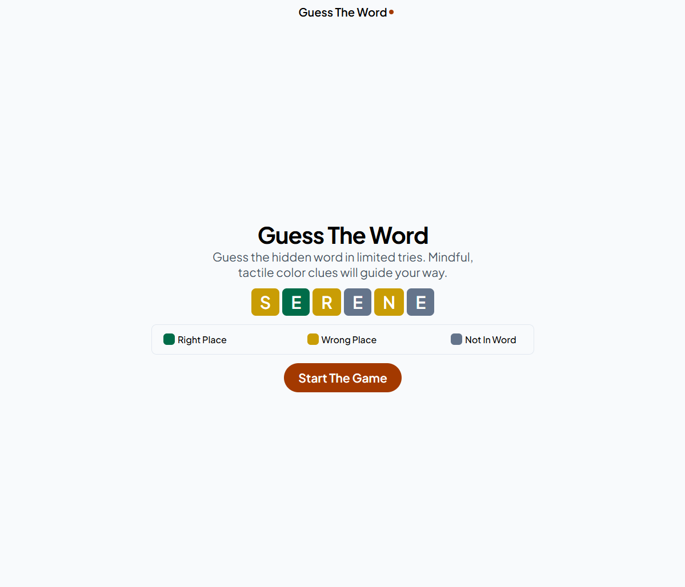
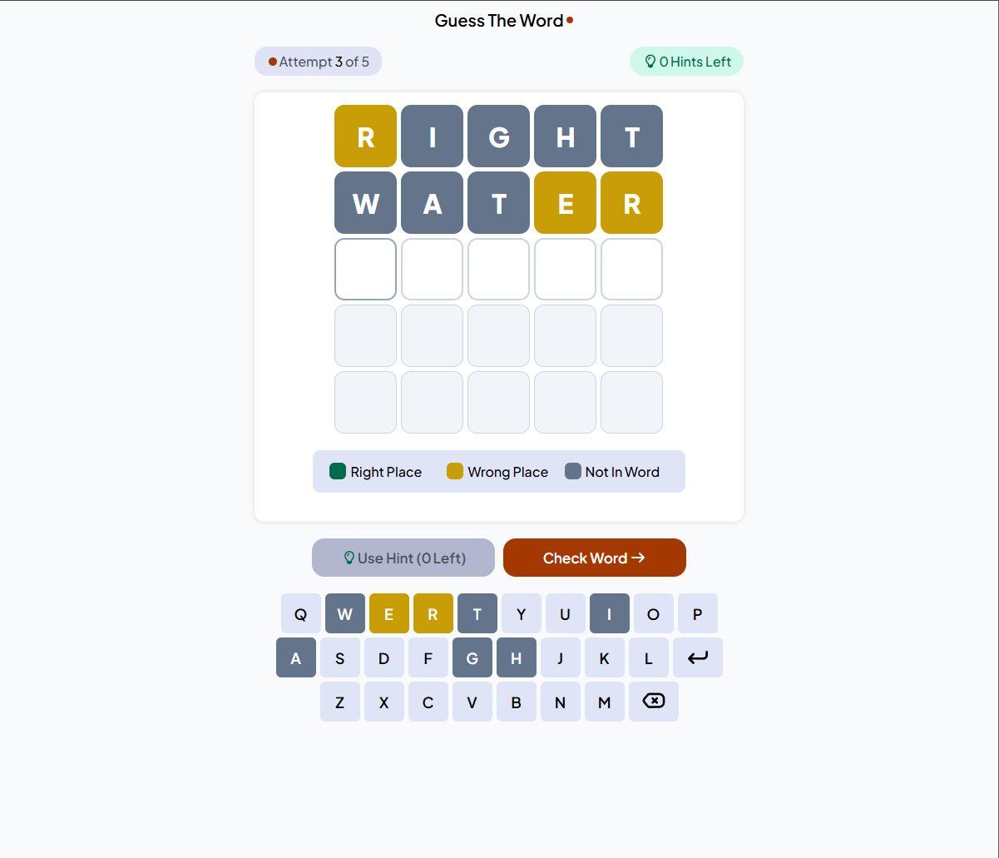
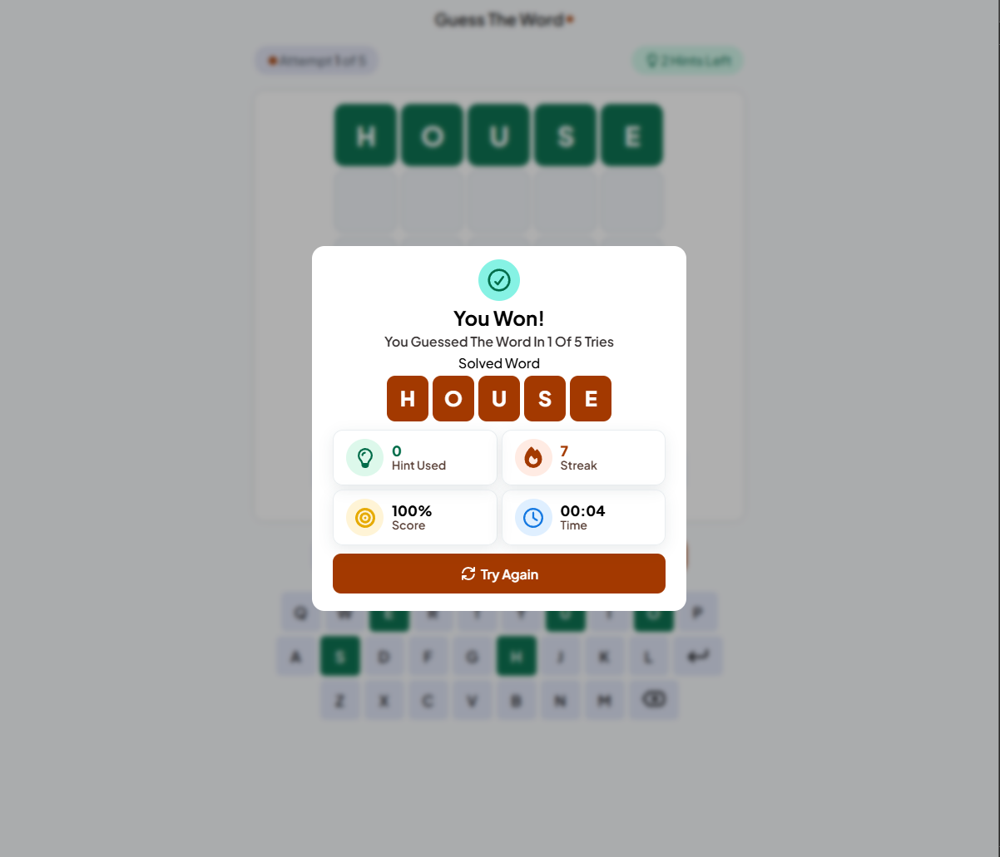

# 🧩 Guess The Word

A responsive Wordle-inspired game built with **HTML5, CSS3, and Vanilla JavaScript (ES Modules)**.

Players try to guess a hidden five-letter word in five attempts, using color feedback and hints to find the answer.

The game includes dictionary validation, physical and on-screen keyboards, round scoring, and a winning streak saved between visits.

---

## 🎮 Live Demo

🔗 [Play Guess The Word](https://basosytech.github.io/Basosy-wordle-game/)

---

## ✨ Features

- 120 possible answers with no immediate repeat between rounds
- Five attempts and two hints per round
- Local dictionary with 11,846 accepted guesses
- Invalid words do not consume an attempt
- Color feedback for correct, misplaced, and absent letters
- Repeated-letter evaluation based on the answer's letter counts
- On-screen and physical keyboard support
- Keyboard colors preserve each letter's strongest known result
- Hints reveal different letter positions within a round
- Keyboard language reminder when entering Arabic letters
- Result dialog with the answer, hints used, and winning streak
- Score and elapsed time displayed after a win
- Persistent winning streak using `localStorage`
- Responsive layout with animated feedback
- No external JavaScript libraries, frameworks, or build tools

---

## 🛠 Technologies Used

### HTML5

- Semantic HTML
- Native buttons and `<dialog>`
- ARIA labels and live status updates
- Reusable SVG icons using `<symbol>` and `<use>`

### CSS3

- CSS Custom Properties
- BEM naming convention
- Flexbox and Grid
- Container queries
- `clamp()` and `min()`
- `:focus-visible`
- Animations and transitions
- `@starting-style` and `allow-discrete`

### JavaScript

- ES Modules
- DOM manipulation and Event Delegation
- `DocumentFragment` and `replaceChildren()`
- `Set` for dictionary lookups
- Guard Clauses
- `localStorage` with error handling
- Native `<dialog>` API
- `performance.now()` for round timing

---

## 🧠 How the Game Works

1. The player selects **Start The Game**.
2. A random word is selected from the answer list.
3. The player enters a five-letter word using the physical or on-screen keyboard.
4. The guess is checked against the accepted-word dictionary.
5. Valid guesses receive color feedback:
   - 🟩 **Green:** correct letter in the correct position.
   - 🟨 **Yellow:** correct letter in another position.
   - **Gray:** no remaining occurrence of that letter in the answer.
6. The player uses the feedback to make another guess or requests a hint.
7. The round ends when the word is solved or all five attempts are used.
8. A result dialog displays the outcome, with **Try Again** starting another round.

A hint reveals a letter and its position through a message. The current guess must be empty before requesting one.

---

## 🔤 Word Validation & Letter Evaluation

The game keeps two separate word collections:

- `words.js`: 120 words used as possible answers.
- `allowed-guesses.js`: a larger `Set` of accepted five-letter guesses, including every possible answer.

Guesses are validated locally using:

```javascript
ALLOWED_GUESSES.has(guessedWord)
```

Letter evaluation happens in two passes: exact matches first, then misplaced letters using the remaining letter counts. This prevents extra repeated letters from receiving incorrect feedback.

Keyboard colors follow the priority `correct > present > absent`, so a later guess cannot downgrade a previously confirmed letter.

---

## 🏆 Score & Winning Streak

The score starts at **100%**. Each attempt after the first deducts **15 points**, and each hint deducts **10 points**. The minimum winning score is **10%**.

For example, solving the word on the third attempt with one hint earns **60%**. Elapsed time is displayed separately and does not affect the score.

Each win increases the winning streak by one; a loss resets it to zero. The streak is saved using `localStorage`, with error handling for unavailable storage.

---

## ♿ Accessibility

- Semantic page structure and native buttons
- Keyboard navigation with visible focus styles
- Accessible labels for icon-only controls
- Grid cell descriptions that include letter results
- Live status messages for game updates
- Result dialog linked to its heading using `aria-labelledby`

---

## 📁 Project Structure

```text
Basosy-wordle-game/
├── favicons/
│   ├── favicon.png
│   └── favicon.svg
├── js/
│   ├── main.js
│   ├── state.js
│   ├── logic.js
│   ├── ui.js
│   ├── utils.js
│   ├── words.js
│   └── allowed-guesses.js
├── licenses/
│   └── wordnik-MIT.txt
├── screenshots/
│   ├── banner-screen.png
│   ├── start-screen.png
│   ├── game-screen.png
│   └── result-screen.png
├── .editorconfig
├── index.html
├── master.css
└── README.md
```

---

## 📊 Architecture Overview

| File | Responsibility |
| --- | --- |
| `index.html` | Page structure, controls, dialogs, and SVG icons |
| `master.css` | Visual design, responsive layout, and animations |
| `js/main.js` | Configuration, events, and round flow |
| `js/state.js` | Game state, resets, and saved winning streak |
| `js/logic.js` | Letter evaluation and score calculation |
| `js/ui.js` | Grid rendering, keyboard feedback, hints, and results |
| `js/utils.js` | Random selection and elapsed-time formatting |
| `js/words.js` | Possible answers |
| `js/allowed-guesses.js` | Accepted-guess dictionary |

Game evaluation and scoring are separated from DOM updates. The UI uses cached DOM references, event delegation, and `DocumentFragment` when creating the grid.

---

## 🚀 How to Run

1. Clone or download the repository.
2. Open the project folder in **VS Code**.
3. Open `index.html` using **Live Server**.

> Use a local development server to load ES Modules. No package installation or build step is required.

---

## 📷 Screenshots

### Start Screen



### Game Screen



### Result Screen



---

## 📚 Word List Credits

The accepted-guess dictionary is derived from the [Wordnik Wordlist](https://github.com/wordnik/wordlist), filtered to unique five-letter English entries and converted to uppercase. It includes uncommon words as well as familiar ones.

The original copyright and MIT license notice are included in [licenses/wordnik-MIT.txt](licenses/wordnik-MIT.txt).

---

## 👨‍💻 Author

**Abdo (BasosyTech)**

- GitHub: [@BasosyTech](https://github.com/basosytech)
